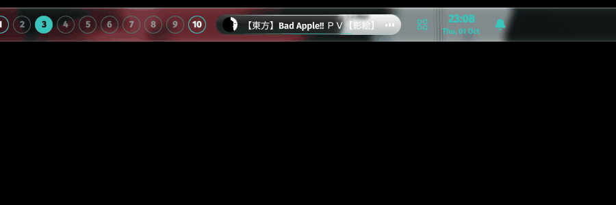
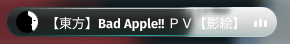
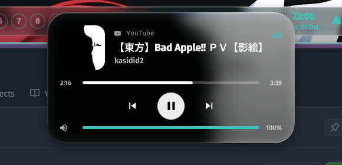

<div align="center">



# MediaControll

**A now-playing capsule for the [ML4W](https://github.com/mylinuxforwork/dotfiles) Quickshell status bar that morphs into a liquid-glass "dynamic island" on hover.**


</div>

---

## Features

- **Capsule in the bar.** Shows cover art, track title and an animated equalizer. Hides itself when nothing is playing.
- **Dynamic island.** Hover the capsule and it springs open into a 420×222 panel with a spring animation.
- **Liquid glass.** A custom GLSL shader refracts the blurred cover art at the rounded edge, with chromatic aberration and a specular rim.
- **Full playback controls.** Previous, play/pause, next, and a seek bar you can drag.
- **Per-app volume.** The slider controls the player's own PipeWire stream, not the whole system. It falls back to the default sink when the player has no stream.
- **Mouse shortcuts.** Scroll on the island changes the volume. On the capsule: left click toggles play/pause, right click skips to the next track, middle click goes to the previous track.
- **YouTube thumbnails.** Firefox often sends no cover art for YouTube. The module builds the thumbnail from the video ID instead, with Shorts support and a fallback for missing `maxres` images.
- **Marquee title.** A long title scrolls when it does not fit.
- **Keyboard navigation.** The module plugs into the bar's `SUPER + SPACE` navigation. <kbd>Return</kbd> toggles play/pause.
- **Follows your theme.** Accent colors come from the ML4W `Theme` singleton (matugen / wallpaper colors).

## Preview

Real screenshots from a Hyprland desktop while Bad Apple!! plays in Firefox.

<table>
<tr>
<td align="center"><b>Capsule in the bar</b></td>
<td align="center"><b>Dynamic island on hover</b></td>
</tr>
<tr>
<td align="center"></td>
<td align="center"></td>
</tr>
</table>

## Requirements

| Dependency | Why |
|---|---|
| [Quickshell](https://quickshell.org) **0.3+** | Shell runtime. Uses `Quickshell.Services.Mpris` and `Quickshell.Services.Pipewire` |
| **Qt 6.9+** (`qt6-declarative`) | `RectangularShadow` and `MultiEffect` from `QtQuick.Effects` |
| [ML4W dotfiles](https://github.com/mylinuxforwork/dotfiles) with the Quickshell status bar | The module is loaded by `StatusbarApp/StatusbarWindow.qml` |
| Hyprland | ML4W compositor (the bar uses `HyprlandFocusGrab`) |
| PipeWire | Per-app volume control |
| An MPRIS player | Spotify, Firefox / Chromium, mpv (`mpv-mpris`), VLC and others |
| [FiraCode Nerd Font](https://www.nerdfonts.com/) | Control and app icons |
| Fira Sans | Text (ML4W default `Theme.fontFamily`) |
| `patch` | Used by `install.sh` |
| Internet access *(optional)* | Fetching YouTube thumbnails |

On Arch Linux:

```bash
sudo pacman -S quickshell qt6-declarative pipewire ttf-firacode-nerd ttf-fira-sans patch
```

## Installation

1. Clone the repository:

   ```bash
   git clone https://github.com/OppaiHacker/MediaControll.git
   cd MediaControll
   ```

2. Run the installer. It copies the QML files and shader into `~/.config/quickshell` and patches `StatusbarWindow.qml` to register the `media` module. A backup of the original is kept as `StatusbarWindow.qml.orig`.

   ```bash
   ./install.sh
   # custom config location:
   QS_DIR=/path/to/quickshell ./install.sh
   ```

3. Add `media` to one of the bar's module lists in `~/.config/ml4w-statusbar/statusbar.json`:

   ```json
   {
       "modules": {
           "left": ["terminal", "workspaces", "media"]
       }
   }
   ```

4. Restart Quickshell:

   ```bash
   pkill quickshell; quickshell &
   ```

### Manual installation

```bash
cp StatusbarApp/MediaModule.qml           ~/.config/quickshell/StatusbarApp/
cp CustomTheme/{LiquidGlass,GlassPanel}.qml ~/.config/quickshell/CustomTheme/
mkdir -p ~/.config/quickshell/CustomTheme/shaders
cp CustomTheme/shaders/liquidglass.frag*  ~/.config/quickshell/CustomTheme/shaders/
patch -p1 -d ~/.config/quickshell < patches/statusbar-media.patch
```

### Uninstall

```bash
cd ~/.config/quickshell
mv StatusbarApp/StatusbarWindow.qml.orig StatusbarApp/StatusbarWindow.qml
rm StatusbarApp/MediaModule.qml CustomTheme/{LiquidGlass,GlassPanel}.qml CustomTheme/shaders/liquidglass.frag*
```

Then remove `"media"` from `statusbar.json`.

## Usage

| Action | Where | Result |
|---|---|---|
| Hover | Capsule | Opens the island |
| Left click | Capsule | Play / pause |
| Right click | Capsule | Next track |
| Middle click | Capsule | Previous track |
| Scroll | Island | Volume ±5% |
| Click / drag | Progress bar | Seek |
| Click / drag | Volume bar | Set volume |
| Click | Volume icon | Mute / unmute |
| <kbd>SUPER</kbd>+<kbd>SPACE</kbd>, arrows, <kbd>Return</kbd> | Bar | Focus the module and toggle play/pause |

When several players are open, the module shows the one that is playing. If none is playing, it shows the first player (for example, a paused browser tab).

## Customization

All visual values are at the top of `MediaModule.qml`:

- `islandW` / `islandH`: island size.
- `BlurArt` properties (`saturation`, `brightness`, `blurMax`, `dimTop`, `dimBottom`): background look.
- `LiquidGlass` properties (`strength`, `bezel`, `aberration`, `blurRadius`, `tintAmount`, `specular`): glass effect.
- `appGlyph`: add icons for more players.

### Rebuilding the shader

The compiled `liquidglass.frag.qsb` is included. After you edit `liquidglass.frag`, rebuild it with `qsb` from `qt6-shadertools`:

```bash
/usr/lib/qt6/bin/qsb --qt6 -o CustomTheme/shaders/liquidglass.frag.qsb CustomTheme/shaders/liquidglass.frag
```

## Project structure

```
MediaControll/
├── StatusbarApp/
│   └── MediaModule.qml          # capsule + dynamic island
├── CustomTheme/
│   ├── LiquidGlass.qml          # refracting glass surface (shader wrapper)
│   ├── GlassPanel.qml           # lightweight glass tint / sheen / rim
│   └── shaders/
│       ├── liquidglass.frag     # GLSL source
│       └── liquidglass.frag.qsb # compiled shader
├── patches/
│   └── statusbar-media.patch    # registers "media" in StatusbarWindow.qml
├── assets/                    # demo GIF and screenshots
└── install.sh
```

## License

[GPL-3.0](LICENSE). The patch modifies ML4W dotfiles code, which is licensed under GPL-3.0.

## Credits

- [ML4W dotfiles](https://github.com/mylinuxforwork/dotfiles) by Stephan Raabe: base status bar and theme.
- [Quickshell](https://quickshell.org): the QtQuick shell toolkit.
